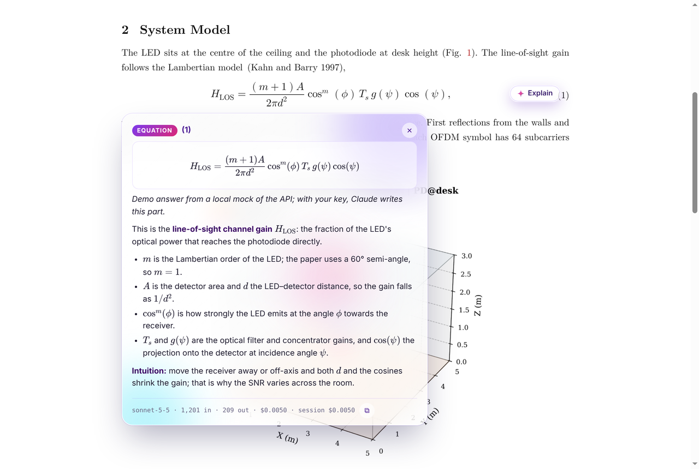
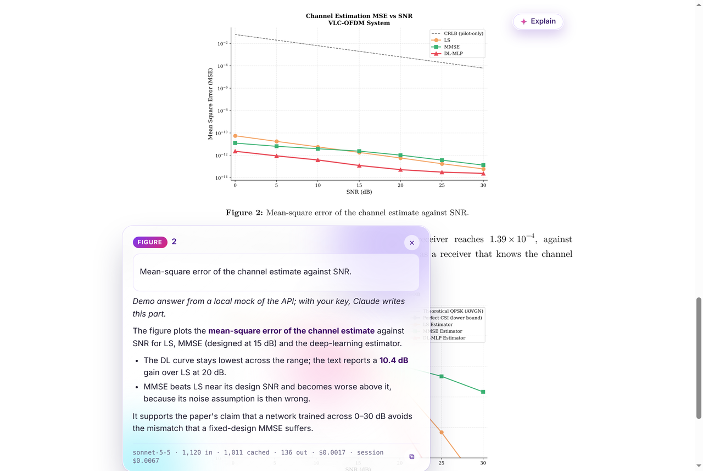
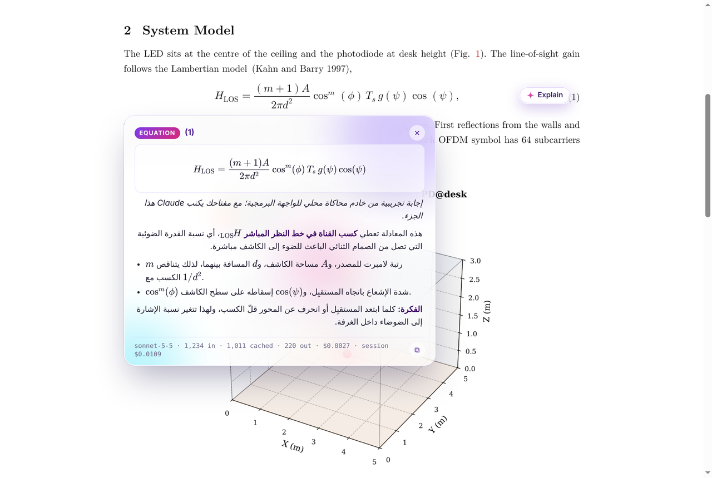
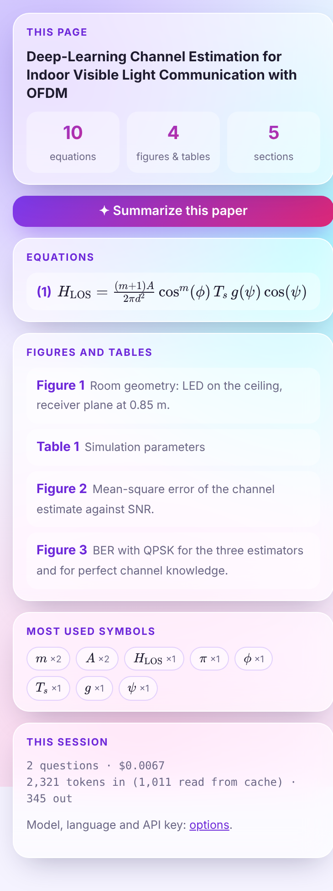
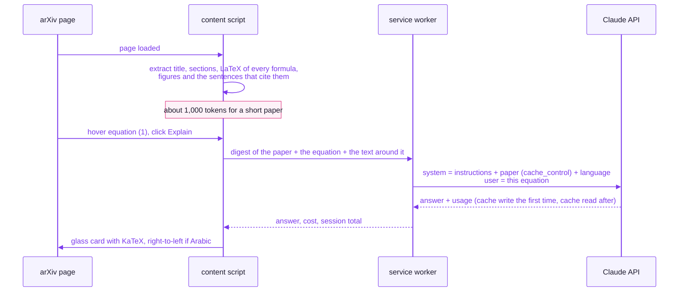
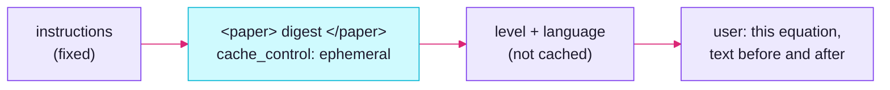
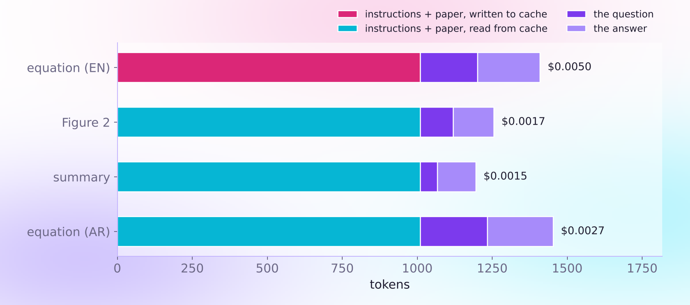
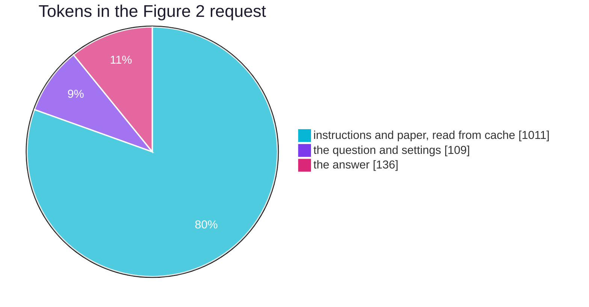
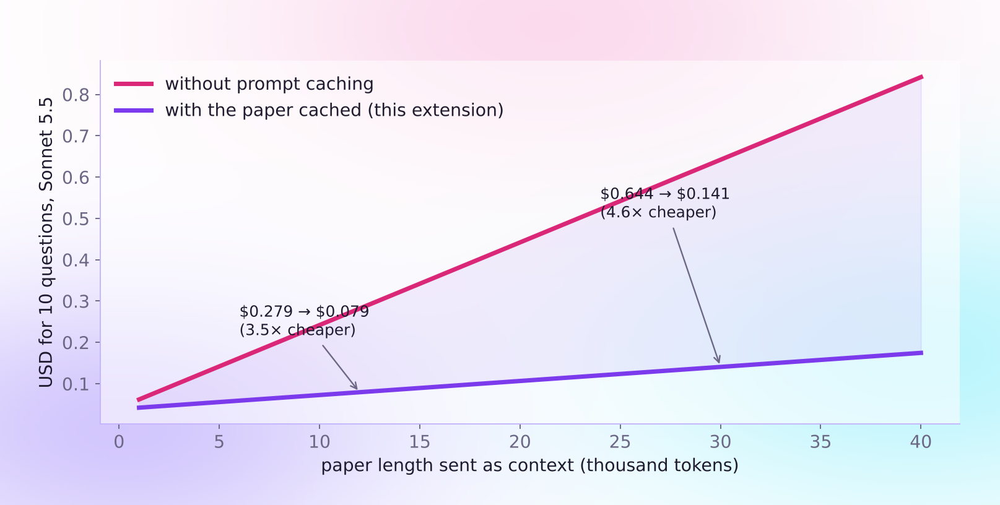

<p align="center"></p>

<p align="center">


</p>

<h3 align="center">Hover an equation or a figure in an arXiv paper. Click <i>✦ Explain</i>.<br>Claude explains it from the paper itself, in your language, and tells you what the answer cost.</h3>

<br>

<table>
<tr>
<td width="33%" valign="top"><h3>∑ Equations</h3>Every symbol with the meaning <b>the paper</b> gives it, what the equation computes, and the intuition. The LaTeX source is read from the page, so Claude sees <code>\frac{(m+1)A}{2\pi d^2}</code>, not a picture.</td>
<td width="33%" valign="top"><h3>📈 Figures and tables</h3>What is plotted against what, the main result, and how it supports the claim, using the caption <b>and every sentence that mentions</b> “Fig. 2”.</td>
<td width="33%" valign="top"><h3>🌍 Your language</h3>English, <b>العربية</b>, Français, Español, Türkçe. Symbols stay in Latin script and formulas stay in LaTeX, so an Arabic explanation still reads correctly next to the paper.</td>
</tr>
<tr>
<td valign="top"><h3>🧭 A map of the paper</h3>The side panel lists every equation, figure and table, the most used symbols, and a one-click summary.</td>
<td valign="top"><h3>💸 Cheap by design</h3>The paper is sent once and <b>cached</b>; every later question reads it from the cache at a tenth of the input price. The cost of each answer is printed under it.</td>
<td valign="top"><h3>🔐 Your key, your browser</h3>No server in between. The key stays in the extension's local storage and is sent only to <code>api.anthropic.com</code>, the one host the extension may reach.</td>
</tr>
</table>

---

## ✦ What it looks like

<p align="center"></p>

<table>
<tr>
<td width="50%"></td>
<td width="50%"></td>
</tr>
<tr>
<td align="center"><sub>Figure 2, explained from its caption and the sentence that cites it</sub></td>
<td align="center"><sub>The same equation in Arabic: right-to-left text, LaTeX left intact</sub></td>
</tr>
</table>



These are real screenshots of this extension, loaded unpacked into Chromium by [`scripts/e2e.py`](scripts/e2e.py) and driven by Playwright: the extraction, the request the extension builds, the KaTeX rendering, the right-to-left layout, the cost line and the side panel are all the real thing.

**Two things are stand-ins, and the screenshots say so.** The page is served to Chromium at an `arxiv.org/html/…` address from a local file, because arXiv cannot be reached from the machine that made them. And the *answer text* comes from a local mock of the Messages API, which is why each answer starts with *“Demo answer from a local mock of the API”*. With your own key, Claude writes that part.

The panel on the right shows the paper map: 10 formulas found, 1 displayed equation with its number, 3 figures and 1 table with their captions, 5 sections, the most used symbols rendered with KaTeX, and the session cost.

<br clear="right">

---

## 🚀 Install

1. `git clone https://github.com/jafarSalim/chrome-paper-explainer`
2. Open `chrome://extensions`, switch on **Developer mode**, click **Load unpacked** and pick the folder.
3. The options page opens: paste an Anthropic API key (from [console.anthropic.com](https://console.anthropic.com)), choose the model, the language and the level (*student* or *researcher*).
4. Open any paper at `arxiv.org/html/…` (the HTML version that arXiv offers next to the PDF), hover an equation or a figure, and click **✦ Explain**.

| Also | How |
|---|---|
| Explain a passage | select text, right-click, **Explain with Claude** |
| An inline formula | double-click it |
| Summary of the paper | the button at the top of the side panel (click the toolbar icon) |
| ar5iv and Wikipedia | work the same way; both keep the LaTeX of every formula in the page |

## 🧠 How it works



**Where the LaTeX comes from.** arXiv's HTML papers are made by [LaTeXML](https://github.com/brucemiller/LaTeXML), which writes the source of every formula into the MathML it produces (`<math alttext="…">` and an `application/x-tex` annotation; see `LaTeXML/Post/MathML.pm`). Wikipedia does the same, and so does pandoc. [`src/extract.js`](src/extract.js) reads that source back, drops `\label` and `\tag`, finds equation numbers from LaTeXML's `ltx_tag_equation`, figure and table numbers from `ltx_tag_figure`, and every paragraph that says *Fig. 2* or *Table 1*.

**Why the request is cheap.** The request has three system blocks in a fixed order: the instructions, the paper (marked `cache_control`), then the reader's language and level. Everything up to the marked block is the cached prefix, so questions about the same paper read it from the cache, **and switching from English to Arabic does not throw the cache away**, because the language comes after it.



## 📏 Measured

### Extraction

Two test pages were made from one real LaTeX paper ([`test/fixtures/source`](test/fixtures/source), a short report on the results of [deep-learning-vlc-ofdm-channel-estimation](https://github.com/jafarSalim/deep-learning-vlc-ofdm-channel-estimation)): pandoc's MathML output unchanged, and the same document re-shaped into the markup LaTeXML writes for arXiv ([`scripts/make_fixtures.py`](scripts/make_fixtures.py) explains exactly how). On both:

| | Found | Checked by the tests |
|---|:---:|---|
| Formulas with LaTeX source | 10 of 10 | the displayed one equals the source in the `.tex`, `\label` removed |
| Equation numbers | (1) | read from LaTeXML's tag |
| Figures and tables | 4 of 4 | captions, numbers, and each one's citing sentence (1 each) |
| Sections | 5 of 5 | titles without numbers |
| Text around the equation | split at the equation | *“…follows the Lambertian model”* before, *“where m is the Lambertian order…”* after |
| Reference list | left out of the digest | the bibliography is not paragraphs |

### What a question costs

The browser run asked four questions about the paper: equation (1), Figure 2, a summary, and equation (1) again in Arabic. These are the requests the extension actually sent, with the token counts the mock reported (counted with an open tokenizer as a stand-in for Claude's) and Sonnet 5.5 list prices:

<p align="center"></p>



The first question writes the paper to the cache; the next three read it, the Arabic one included. For this short paper that is $0.0050 for the first question and $0.0015 to $0.0027 for the others.

Real papers are longer, which is where caching pays. Keeping the measured question size and assuming answers of 350 tokens:

<p align="center"></p>

| Ten questions about one paper, Sonnet 5.5 | Without caching | With the paper cached |
|---|---:|---:|
| 12,000-token paper | $0.28 | **$0.08** (3.6× less) |
| 30,000-token paper | $0.64 | **$0.14** (4.6× less) |

The cache lives five minutes after its last use, which matches how people read: a burst of questions about one paper. Haiku 5.5 is the cheap option in the options page; Opus 5.5 the careful one.

## 🧪 Tests

```bash
npm install
npm test                 # 13 tests: extraction on both pages, context split, digest, symbols, Wikipedia math,
                         # request layout and caching order, prices, API errors, safe Markdown, manifest
npm run e2e              # the browser run: real extension, mock API, screenshots → results/  (needs xvfb and Playwright)
npm run charts
```

The renderer escapes everything before it formats anything: an answer containing `` comes out as text, which the tests check.

## 🗂️ Layout

```text
chrome-paper-explainer/
├── manifest.json         MV3: storage, contextMenus, sidePanel; host permission for api.anthropic.com only
├── background.js         service worker: settings, the API call, session cost per tab, context menu
├── content.js            hover pills, the glass card (in a shadow root), messages from the side panel
├── sidepanel.html/.js    the paper map
├── options.html/.js      key, model, language, level, optional proxy address
├── src/
│   ├── extract.js        title, sections, LaTeX of formulas, figures and their mentions, digest, context
│   ├── claude.js         request layout with caching, Messages API call, prices and cost
│   ├── render.js         safe Markdown with KaTeX, right-to-left aware
│   └── panel.css         the glass look, light and dark
├── vendor/katex/         KaTeX 0.16 (MIT), woff2 fonts only
├── test/                 unit tests, the two test pages and their LaTeX source
└── scripts/              make_fixtures.py, e2e.py (browser run + mock API), charts.py
```

## ⚠️ Limits

* It reads **HTML** papers. For a PDF-only paper, open the arXiv HTML version if there is one (most recent papers have it).
* Formulas drawn as images, with no LaTeX kept in the page, cannot be explained as formulas.
* The digest is capped at 60,000 characters; for very long papers the end is cut and the digest marks the cut.
* Answers are only as good as the paper and the model. The instructions tell Claude to stay with what the paper says and to say when it does not say something; read the answer next to the paper.

---

<p align="center"><b>Eng. Jaafar Salim</b> · University of Technology, Iraq · <a href="https://github.com/jafarSalim">github.com/jafarSalim</a><br>
Read papers in your own language without leaving the page. If it helps, a ⭐ helps others find it.</p>
